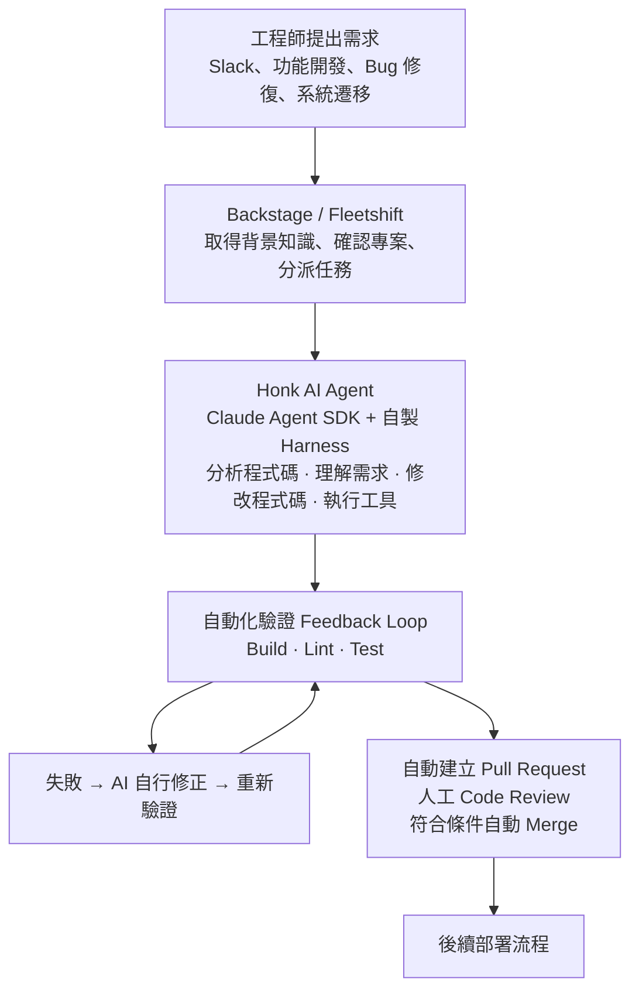
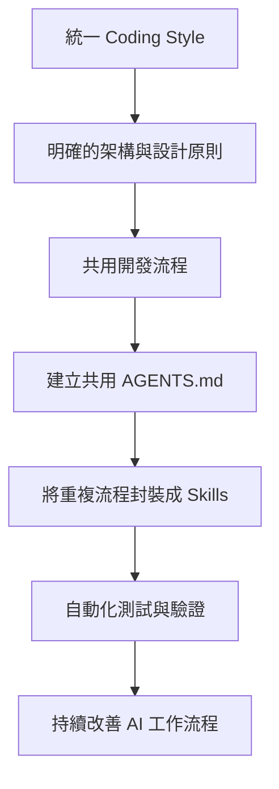
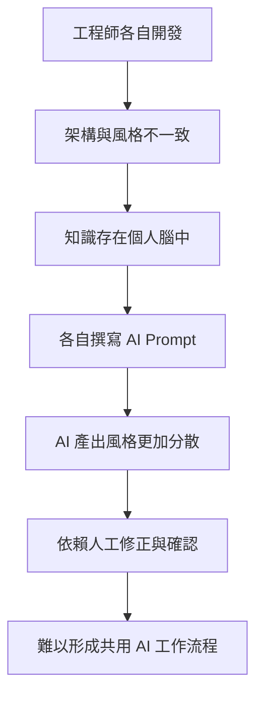

# Spotify AI工作流程

> 本檔依原對話順序匯出。原對話的引用、日期、數據與技術主張均未重新查證。介面圖表已轉為 Markdown 表格、目錄樹或 Mermaid 流程圖。Spotify 的行內引用保留原位置與識別碼，並連到同一回答的網頁來源清單。原對話最後的匯出進度回覆一併保留。
>
> [原對話](https://chatgpt.com/c/6b06343d-de38-83ec-9b96-8b45fe6e8eed)

## Spotify AI 工作流程

**使用者**

spotify 之前有發表過什麼ai工作流程嗎 印象中好像是有

**ChatGPT**

有，你的印象應該沒錯。Spotify 從 2025 年 11 月開始，陸續透過官方工程部落格公開一系列 **AI Agent 軟體開發工作流程（Agentic Development Workflow）** 的技術文章。

其中最具代表性的就是 **Honk**，Spotify 自行開發的背景 AI Coding Agent。

它不只是讓工程師使用 AI 輔助撰寫程式碼，而是將 AI 整合進整個軟體開發、測試、維護及交付流程。

### 一、Spotify 公開的 AI 開發技術

| 名稱 | 用途 |
|--------|--------|
| Backstage | 提供專案資訊、系統架構、依賴關係等背景知識 |
| Fleet Management | 大規模軟體維護及自動化管理 |
| Fleetshift | 任務分配、排程、執行進度追蹤 |
| Honk | 背景執行的 AI Coding Agent |
| Chirp | 多 Agent 協調與團隊協作 |
| Xirp | 不綁定特定 AI 廠商的 Agent 開發環境 |

這些工具共同組成 Spotify 的 AI 開發基礎設施。 [Spotify Engineering +1](#spotify-web-sources)<!-- 原引文 turn257440search0, turn257440search8 -->

### 二、Spotify 的 AI 工作流程

以下是我依照官方公開資料整理的簡化架構，並非官方原始架構圖。



這套流程的核心是 AI 不需要工程師一直在電腦前進行互動，可以在 Kubernetes 的雲端環境中背景執行多個任務，並且利用 CI 環境驗證修改結果。 [Spotify Engineering +1](#spotify-web-sources)<!-- 原引文 turn257440search0, turn257440search6 -->

### 三、Spotify 公開的 AI 導入成果

根據 Spotify 2026 年 6 月 3 日公布的資料：

| 指標 | 數值 |
| --- | --- |
| 每週使用 AI 開發工具的工程師 | 99%+ |
| 認為 AI 提高生產力的工程師 | 94% |
| Pull Request 頻率增幅 | +76% |
| 近期一次後端 Java 遷移耗時 | 3 天 |

另外，Spotify 的 Fleet Management 系統累計已合併超過 250 萬筆自動化維護 PR，大部分不需要人工介入。不過這個數字也包含傳統自動化，並非全部由 AI 產生。 [Spotify Engineering +1](#spotify-web-sources)<!-- 原引文 turn257440search0, turn257440search2 -->

### 四、Spotify 官方技術文章

你之前看到的有可能是以下其中一篇。

| 發表日期 | 主題 |
|--------|--------|
| 2025/11/06 | Honk Part 1：背景 AI Coding Agent |
| 2025/11/24 | Honk Part 2：Context Engineering（上下文工程） |
| 2025/12/09 | Honk Part 3：Feedback Loop（回饋迴圈） |
| 2026/04/22 | Honk Part 4：大型資料集遷移 |
| 2026/06/03 | 程式碼撰寫不再是開發瓶頸 |
| 2026/08/10 | Xirp：大規模 AI Agent 開發環境 |

原始官方資料：

- [Honk Part 1 — Spotify 的背景 Coding Agent](https://www.engineering.atspotify.com/2025/11/spotifys-background-coding-agent-part-1)
- [Spotify Engineering 開發者體驗系列文章](https://engineering.atspotify.com/tag/developer-experience)
- [Coding Is No Longer the Constraint](https://engineering.atspotify.com/2026/06/code-with-claude-coding-is-no-longer-the-constraint)
- [Xirp — What we've learned scaling AI coding agents at Spotify](https://portal.spotify.com/blog/introducing-xirp)
- [Spotify × Anthropic 技術研討會（YouTube）](https://www.youtube.com/watch?v=fHDGQHr_agg)

### 五、對你使用 Codex 開發有什麼參考價值？

以你目前使用 Codex App、Codex CLI 開發及維護 C\#、.NET 專案的情況來看，其實不需要導入 Spotify 整套大型基礎設施，也可以借鏡它的工作流程。

| Spotify 做法 | 你可以採用的方式 |
|--------|--------|
| Context Engineering | AGENTS.md、專案架構文件 |
| Background Agent | Codex 背景任務 |
| Agent Harness | Codex 搭配自訂工具及 Hooks |
| Feedback Loop | dotnet build、dotnet test |
| 任務協調 | Codex Subagents |
| 自動驗證 | GitHub Actions |
| 人工審查 | Git Diff、Pull Request |
| 可重複執行的流程 | Skills |

我比較推薦你先閱讀 **Honk Part 2 與 Part 3**。

這兩篇最值得一般軟體工程師參考，因為不需要像 Spotify 一樣擁有數千名工程師，也能實際應用在個人開發流程中。

Spotify 這套工作流程真正值得研究的地方，不是它使用哪個 LLM，而是 **如何透過 Context Engineering、Harness Engineering 和 Feedback Loop，讓具有不確定性的 AI Agent，產出可驗證、可維護且可信任的程式碼。**

## Uber、Coding Style 與工程標準化

**使用者**

[`https://www.uber.com/us/en/blog/optimizing-ubers-agent-skills/`](https://www.uber.com/us/en/blog/optimizing-ubers-agent-skills/) uber也有. 要發展出這種工作流程的是不是都是有在規範coding style的開發team比較會發生 相較於一般沒有規範 style 大家各做各的很難 演化出這種行為

**ChatGPT**

我認同你的觀察，而且我認為這正是 **AI Native Software Development（AI 原生軟體開發）能否成功落地的一個重要前提**。

像 Spotify、Uber 這類公司能夠發展出成熟的 AI Agent 工作流程，不單純是因為他們有更多資金、更強的模型或更多工程師，而是因為他們本身就具備相對成熟的軟體工程規範與基礎設施。

不過，Coding Style 只是其中一部分，更重要的是整個團隊的**工程標準化程度（Engineering Standardization）**。

### 一、Uber 這篇文章其實非常符合你的觀察

你提供的文章是 Uber 在 2026/11/23 發表的 [How Uber Evals 1 Million Agent Skill Invocations a Month](https://www.uber.com/us/en/blog/optimizing-ubers-agent-skills/)。

| 指標 | 數值 | 說明 |
| --- | --- | --- |
| 企業內部 Skills 數量 | 5,000+ | 2025 年 10 月從 1 個開始 |
| 單月 Skills 呼叫次數 | 100 萬+ | 跨多種 AI Agent 平台 |

Uber 將既有的工作流程、團隊操作程序及資深員工的經驗封裝成 Skills，並透過 Git Repository、審查機制、自動化評估及使用數據持續維護。

甚至連 Skills 本身都有規範：

- 每一個步驟都有明確目標。
- 每一個步驟都應有驗證方式。
- 必須定義錯誤發生時的處理方式。
- 必須評估 Skill 是否真的改善結果。
- 必須有負責維護的人員。

換句話說，他們不只是規範人類如何開發軟體，現在也開始規範 AI 如何工作。 [Uber](https://www.uber.com/us/en/blog/optimizing-ubers-agent-skills/)

### 二、有規範與沒有規範的開發團隊差異

**有工程規範的團隊**



**缺乏工程規範的團隊**



以上是我對兩種團隊可能發展方向的推演，並非 Uber 官方的研究結論。

最大的差異在於，前者能夠將個人的 AI 使用經驗轉化為**組織的共同資產**，後者則容易停留在個人生產力提升的階段。

### 三、舉例：以 C\# .NET 開發團隊來說

假設有五位工程師，負責開發不同的 ASP.NET Core 專案。

#### 情境 A：沒有統一規範

| 項目 | 工程師 A | 工程師 B | 工程師 C |
|--------|--------|--------|--------|
| 資料存取 | EF Core | Dapper | ADO.NET |
| 架構 | 三層式 | Clean Architecture | 直接寫在 Controller |
| 錯誤處理 | Middleware | try-catch | 自訂處理方式 |
| 命名規則 | PascalCase | 自訂 | 不固定 |
| 單元測試 | 有 | 沒有 | 部分有 |
| AI 指令 | 個人 Prompt | 個人 Prompt | 個人 Prompt |

此時，如果公司想建立一個共用 Skill：

```text
create-web-api
```

AI 就會面臨很多不確定性。

應該使用什麼架構？應該使用什麼資料存取方式？如何處理 Exception？API 回傳格式是什麼？完成之後如何驗證？

管理者甚至難以定義什麼樣的 AI 產出才算合格。

#### 情境 B：有統一規範

假設團隊已經制定以下標準：

| 項目 | 團隊規範 |
|--------|--------|
| Framework | \.NET 10 |
| 架構 | Controller → Service → Repository |
| 資料存取 | Dapper |
| API 回傳 | 統一 ApiResponse |
| 錯誤處理 | Global Exception Middleware |
| 日誌 | Serilog |
| 命名規範 | Microsoft C\# Coding Conventions |
| 程式註解 | 繁體中文 XML Summary |
| 驗證方式 | Build + Unit Test |

此時就很容易將原本的開發規範轉換成 AI Skills。

**共用 AI 開發資源 Repository**

```text
├── AGENTS.md              團隊通用開發規範
├── .editorconfig          程式碼格式規範
└── skills/                共用 AI 工作流程
    ├── create-web-api/    新增 RESTful API
    ├── create-service/    新增 Service
    ├── create-sql-migration/  資料庫異動
    ├── code-review/       程式碼審查
    ├── generate-unit-test/    產生單元測試
    ├── fix-build-error/   修復編譯錯誤
    └── deploy-iis/        IIS 部署流程
```

這樣即使每位工程師使用不同的 AI 模型，仍然可以遵循相同的工程規範與工作流程。

當然，不同專案也可以有不同的技術選型，重點不是強制所有專案使用相同架構，而是每個專案的規則都必須明確。

### 四、Coding Style 其實只是最基礎的一層

我會將 AI 開發團隊的成熟度分成六個階段。這是我自行整理的分析框架，並非業界正式標準。

| 階段 | 名稱 | 說明 |
| --- | --- | --- |
| Level 0 | 個人化開發 | 大家各自開發，沒有共用規範 |
| Level 1 | Coding Standard | 命名、格式、註解、Coding Style |
| Level 2 | Architecture Standard | 架構、設計模式、專案結構 |
| Level 3 | Workflow Standard | 開發、測試、審查、部署流程標準化 |
| Level 4 | Agentic Workflow | Skills、Context、Harness、Agent 自動化 |
| Level 5 | Self-improving Workflow | Evals、Feedback Loop、持續改善 Skills |

從公開文章來看，Uber 與 Spotify 的部分工程流程已經具備 Level 4、Level 5 的特徵。

如果一個團隊還處於 Level 0 或 Level 1，即使公司購買大量 AI 授權，也不代表能直接達到 Level 4。

### 五、Uber 最值得注意的是 AI 工作流程能持續演化

Uber 不只是建立 Skills，還讓 Agent 回報執行過程中遇到的問題，將實際失敗案例納入評估與改善流程。 [Uber](https://www.uber.com/us/en/blog/optimizing-ubers-agent-skills/)

這才是長期下來真正可能拉開企業開發效率差距的地方。

有規範的團隊，每次 AI 犯錯，都有機會改善共用的工作流程，讓其他工程師受益。

沒有規範的團隊，每次 AI 犯錯，通常只是當下的工程師自行修正，其他工程師下次仍可能遇到相同的問題。

### 六、AI 會放大原本的工程文化

| 比較項目 | 有規範的團隊 | 缺乏規範的團隊 |
|--------|--------|--------|
| 個人開發速度 | 提升 | 提升 |
| 程式碼一致性 | 容易維持 | 可能更加分散 |
| 知識共享 | 容易累積 | 依賴個人 |
| Skills 重複利用 | 高 | 受限 |
| AI 自動化程度 | 容易擴展 | 容易遇到瓶頸 |
| 人員交接 | 相對容易 | 依賴原開發者 |
| 長期維護成本 | 有機會降低 | 可能增加 |
| 組織生產力 | 有機會持續累積 | 主要是個人效率提升 |

不過，沒有規範的團隊也不是無法發展出這種工作流程。反過來也可以利用 AI 盤點現有專案、建立規範、補齊測試，逐步改善工程文化，不必等到所有規範都完善才開始導入。

### 七、未來企業的競爭力

我認為未來軟體開發公司的 AI 競爭力，將不只是取決於：

- 使用哪一個 AI 模型。
- 購買多少 AI 授權。
- 工程師是否擅長 Prompt Engineering。

而是取決於企業能否將自己的**工程知識、開發經驗、業務邏輯、操作流程轉化為 AI 可以理解、執行、驗證及重複使用的資產**。

LLM 可以更換，AI Coding Agent 可以更換，但企業長期累積下來的工程規範、Skills、測試案例與工作流程，才是企業自身的資產。

**過去制定 Coding Style 和開發規範，主要是為了讓人與人之間更容易協作；未來制定這些規範，還有一個重要目的，就是讓人與 AI，以及 AI 與 AI 之間能夠有效協作。**

這也是為什麼我認為，AI 時代的軟體工程規範不會變得比較不重要，反而會比以前更加重要。

## 匯出請求

**使用者**

產出markdown格式檔案給我 完整討論串內容

**ChatGPT**

已建立 Work 工作對話，將完整討論串整理成 UTF-8 編碼的 Markdown（.md）檔案。

內容將包含：

- Spotify Honk 與 AI Agent 開發工作流程。
- Uber Agent Skills 與持續改善機制。
- Coding Style 與工程標準化的重要性。
- 有規範與無規範開發團隊的比較。
- C#／.NET 開發團隊的實際案例。
- AI 開發團隊的六個成熟度階段。
- Feedback Loop 與組織知識累積。
- 未來企業的 AI 軟體開發競爭力。
- 原始提問、完整回答、比較表格及參考連結。

原本的視覺化流程圖將轉換成 Markdown 或 Mermaid 流程圖，方便在 VS Code 中閱讀及維護。

預定檔名：`AI_Agent_Workflow_and_Engineering_Standardization.md`

會保留完整討論內容，而非僅提供摘要。原討論中的引用資料不會重新查證，並會在文件內註明。

檔案將由新建立的 Work 對話產出，目前尚未完成。

<a id="spotify-web-sources"></a>

## 原對話的 Spotify 網頁來源

- [Coding Is No Longer the Constraint: Scaling Developer Experience to Teams and Agents at Spotify](https://engineering.atspotify.com/2026/6/code-with-claude-coding-is-no-longer-the-constraint?utm_source=chatgpt.com)
- [What we've learned scaling AI coding agents at Spotify](https://portal.spotify.com/blog/introducing-xirp?utm_source=chatgpt.com)
- [How Spotify Built Honk](https://backstage.spotify.com/how-spotify-built-honk?utm_source=chatgpt.com)
- [Coding Is No Longer the Constraint: Scaling Developer Experience to Teams and Agents at Spotify](https://engineering.atspotify.com/2026/06/code-with-claude-coding-is-no-longer-the-constraint?utm_source=chatgpt.com)
- [Coding Is No Longer the Constraint: Scaling Developer Experience to Teams and Agents at Spotify \| Spotify Engineering](https://www.engineering.atspotify.com/2026/6/code-with-claude-coding-is-no-longer-the-constraint?utm_source=chatgpt.com)
- [Background Coding Agents: Supercharging Downstream Consumer Dataset Migrations (Honk, Part 4) \| Spotify Engineering](https://www.engineering.atspotify.com/2026/4/background-coding-agents-dataset-migrations-honk-part-4?utm_source=chatgpt.com)
- [Let’s Talk Agentic Development: Spotify x Anthropic Live \| Spotify Engineering](https://engineering.atspotify.com/2026/4/anthropic-agentic-development?utm_source=chatgpt.com)
- [1,500+ PRs Later: Spotify’s Journey with Our Background Coding Agent (Honk, Part 1) \| Spotify Engineering](https://www.engineering.atspotify.com/2025/11/spotifys-background-coding-agent-part-1?utm_source=chatgpt.com)
- [Developer Experience Archives \| Spotify Engineering](https://engineering.atspotify.com/tag/developer-experience?utm_source=chatgpt.com)
- [Developer Experience Archives \| Spotify Engineering](https://www.engineering.atspotify.com/tag/developer-experience?utm_source=chatgpt.com)
- [Spotify’s official technology blog \| Spotify Engineering](https://engineering.atspotify.com/?trk=article-ssr-frontend-pulse_little-text-block&utm_source=chatgpt.com)
- [Platform Archives \| Spotify Engineering](https://www.engineering.atspotify.com/tag/platform?utm_source=chatgpt.com)
